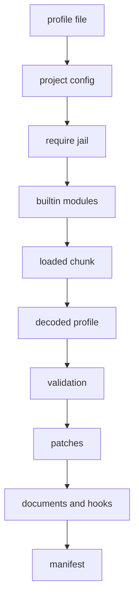
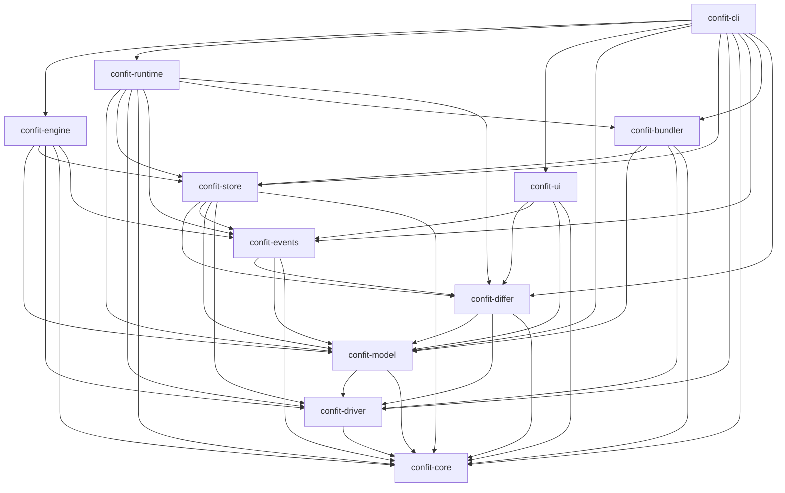

# ConfIt architecture

Eleven crates form one acyclic graph. Each crate is a single
domain unit. Each crate owns a single conceptual set of actions.
Each crate definition fits in a single line.

## Store

Store is the confit controlled resource management. It owns all managed files
with a fixed path at evaluation time. That includes:

- User project files.
- Pool blobs.
- Cache files.
- Named states.
- History states.

One Stores set exists per execution. Main builds it once and all phases use
that set. The set splits into subdomains because placement and generation need
different owners. Placement owns where files live. Generation fills the cache
during evaluation.

### Placement stores

They own where confit files live during the execution.

#### Resources store

It owns user project files and the cache files derived from them. It is the
only subdomain that serves project paths to the rest of the execution.

#### Pool store

It owns confit blobs. It keeps the long term content that states reference
and that the cache reuses across executions.

#### State store

It owns named states and history states. It keeps the applied history and the
rescue state for the next comparison.

### Operation stores

They generate managed files in the cache during evaluation.

#### Fetch store

It is in charge of web resources. It downloads, verifies, and stores each
requested URL in the cache.

#### Archive store

It is in charge of archive members. It lists, verifies, and stores each
unpacked member in the cache.

## Engine

Engine is the Lua profile evaluator. It evaluates one profile file into one
manifest. It keeps the require jail during evaluation. The jail decides what
require loads and what it rejects:

- `confit.*` loads a builtin module.
- Other names load a project file relative to the project root.
- `plugins.*` loads a plugin file relative to the plugins folder.
- Paths outside the scope fail.

Project config controls the jail:

- `project.toml` sets the plugins folder.
- `allow_external_folders` controls whether plugins resolve outside the root.

Assembly validates the profile, merges patches into documents, and collects
hooks from the same value.

Api exposes one module per file:

- `archive`, `config`, `fact`, `fetch`, `global`, `input`, `open`, `patch`,
  `profile`, `render`, `resource`, `validate`.

For module shapes and calls see `../crates/engine/src/stubs.rs`.

## Differ

Differ is the state and disk comparison engine. It compares wanted, recorded,
and disk state. It builds three views. Each view answers one question.

### Desired view

It compares wanted against recorded. It shows what changed since the last
applied state.

### Drift view

It compares recorded against disk. It shows what moved on disk outside of
confit.

### Effective view

It compares wanted against disk. It drives file writes and hook decisions.

## Runtime

Runtime is file changes and hook execution. It consumes the
effective rows in view order. It writes files and removes
dropped paths. It runs hooks after the files land. Checks
decide the hooks. Each hook resolves its binary against the
hook PATH and the process PATH, runs without a shell, and
writes its output to a log file under the run hooks folder.

Runtime holds no pool and no history. Store keeps those.

## Model

Model holds the high level domain entities. It is the shared
confit language. Its entities live from Lua to disk. Document,
Route, Hook, Condition, Manifest, Arg, and the state pickers.
A profile builds them. A manifest stores them as references.
Stores resolve the resource side. Runtime fills the disk side.

Routes keep bundles portable. A route pairs a base with a
relative path. The host path resolves at write time.

## Bundler

Bundler is the confit package protocol. It packs the manifest with all files
needed to reconstruct the whole state into one portable `.cb` file. It
unpacks in the opposite direction and restores the same state on any system
with the same facts. Routes stay symbolic inside, so a bundle applies across
systems.

## Driver

Driver is the confit layer over third-party libs. It makes
third-party code talk the confit language. It is the weakest
domain crate. It wraps filesystems, http, archives, processes,
and paths in the small surface confit needs. Side effects stay
contained behind traits. Test doubles stand behind feature
guards. Real backends link in production builds.

## Core

Core holds the basic shared entities across the program.
Errors, hashes, and references. Every crate needs them.

## Events

Events is the ui protocol. Progress, preview, prompts, and
confirmations travel as typed variants. Workers send. Ui
renders and answers.

## Ui

Ui is the multi-backend terminal system over the events
protocol. It owns stderr and stdin. It manages user interaction
and progress reporting. Workers send typed events, so each
backend renders the same protocol. The split lets each backend
present one execution in the way its users need.

## Cli

Cli is the entry point. It takes flags and the user request, prepares
logging, the Ui backend, the store roots, and the store set, executes one
command flow through the domain crates, and prints the deliverable to stdout
when requested.

## Commands

A command is one full user request. It runs phases in order
and returns one deliverable. The phase sequence defines the
command.

## Phases

A phase is one complete task. It states inputs, outputs, and
side effects. Its value is the derivable. Evaluate gives the
profile. Assembly gives the manifest. Compare gives the diff.
Packaging gives the bundle. Commit gives the written disk.

## Life cycle

One apply runs evaluate, assembly, compare, then commit. The
diff passes between them. Each phase reads the last derivable
and produces the next.

## Crate map

Eleven members. One charge each.

| Crate | Charge |
| --- | --- |
| `core` | Basic shared entities across the program |
| `events` | The ui protocol |
| `driver` | Confit layer over third-party libs |
| `bundler` | Confit package protocol |
| `store` | Confit controlled resource management |
| `model` | High level entities from Lua to disk |
| `engine` | Lua profile evaluator |
| `differ` | State and disk comparison engine |
| `runtime` | File changes and hook execution |
| `ui` | Multi-backend terminal over the events protocol |
| `cli` | Flags, commands, deliverable printing, and exit codes |

## Dependencies stay acyclic

The graph shows the production edges. The domain crates build
in one direction.

