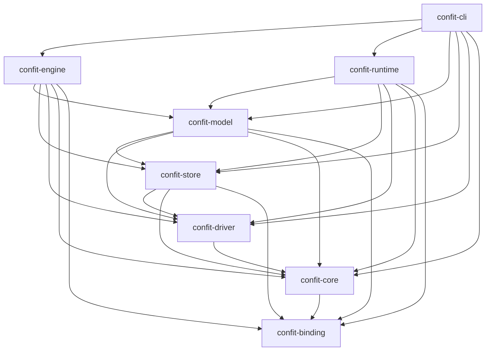

# ConfIt architecture

If you open the workspace you find nine crates. That looks like a lot. In
practice you only track four ideas. What I control. What I do not. The shapes
both sides share. The toolkit that moves those shapes through Lua.

I keep the dependency graph acyclic. That habit comes from old Nim pain. It has
no deep meaning here beyond faster builds and tidy folders. The domain drives
the layout. The graph just follows.

## Stores own the controlled world

Stores are the parts I know up front. Project files under the folder you pass as
project. The pool of blobs keyed by hash. The fetch cache for downloads. The
unpacked archives keyed the same way. Slots and history under the config folder.

When Lua needs a file it never touches disk directly. It gets a handle from
stores. A Project handle points at a trusted path with its hash. A Cache handle
points at bytes I already verified. Lua calls text, load or archive on the
handle and stores do the read.

## Runtime meets the wild world

Runtime is everything I do not control. Home folders and config paths. Files the
user edited by hand. Hooks that may fail. Checks for binaries on PATH.

Runtime takes the desired manifest and compares it with disk and with the
previous manifest. That diff drives the preview you see in plan. Then Writer
lands the controlled bytes where they belong. It writes documents per kind and
removes state recorded paths absent in desired documents. Hooks run after the
files land, guarded by changed routes and requires checks.

## Model has the shared shapes

Model is the vocabulary both sides speak. Document, Route, Hook and Condition. A
profile builds them with live handles. A manifest stores them with hashes. It is
the same type through the whole run. Stores fill the live side. Runtime fills
the preserved side. The life cycle is a collaboration between the two.

Routes keep bundles portable. A bundle applies on any system with the same
facts. Version, os and arch. A route is composed of a base like home, config,
data, cache or literal and a relative path. The real folder resolves only when
runtime writes. That keeps fixtures portable and tests honest.

## Engine turns Lua into documents

Engine owns evaluation. Loader sets up the VM. Project reads the project file
and finds plugins. Api installs the builtin modules like fetch, open and
template. Assembly walks the returned profile value into documents and hooks.

You never call engine alone. Cli builds Stores once and hands them to engine
through Lua app data. Every Lua callback reads them back the same way.

## Cli is the thin surface

Cli parses flags and runs one action. Plan, apply, export, delete and init.
Actions call engine, then runtime build and prepare, then presentation renders
the diff. Progress flows through one channel into sinks.

Main builds stores and wires the rest. Nothing effectful lives in main or flag
parsing. Effects hide behind driver and stores.

## Driver is its own domain

Driver abstracts third party libs into the small surface confit needs.
Filesystem helpers, http, archive framing, process runs and path helpers speak
at confit level and hide external formats behind it. Side effects stay contained
through conditional compilation. Test doubles live behind feature guards and
test guards. Production builds link the real backends alone.

## Binding is the odd one out

Binding stays agnostic from confit. Faces, values, registries and stubs work for
any Lua API. I started with mlua with serde support, mlua-extras and typed
userdata. The readme promises did not compile. Errors read too Rust oriented for
Lua users. Stubs stayed weak. Only typed userdata proved useful. I wanted what
zua gives me in Zig. Simple structs as single source for docs, encode logic and
decode logic. Zua is mine and Zig only, and the project was too far along to
move to Zig. So I wrote that zua in Rust here. Treat it like a vendored lib and
keep it agnostic. A future extraction should need no confit changes.

Binding macros only feed the derive at build time. They generate the glue
between Rust structs and Lua tables so model and stores never hand write push
and pop loops.

Core is confit DNA. Errors, hashes and progress events live here because every
crate needs them. If you change how failures print, you change core.

## Life cycle in four moves

You run a profile and four moves carry it to disk.

1. Engine evaluates it into documents with live handles and hooks.
2. Runtime builds the desired manifest and fills hashes over rendered bytes.
3. Runtime prepares the diff. On first run it diffs desired state against disk.
   Later it diffs recorded state against disk and desired state against recorded
   state. Behind that diff stores skip repeated work. Fetch cache skips
   downloads it already cached. Archive store skips unpacks it already unpacked.
   Pool skips blobs already present.
4. Runtime writes. Text and structured payloads stay inline in the manifest.
   Opaque bytes and trees stay in the pool by hash. State records the applied
   slot and rotates history.

## Crate map

Nine crates. One job each.

| Crate | It owns |
| --- | --- |
| binding | Lua faces, values, registries and stubs |
| binding-macros | Derive glue for faces at build time |
| core | Errors, hashes and progress events |
| driver | Filesystem, http, archive, process and path helpers |
| store | Project files, pool, fetch cache, archives, slots and history |
| model | Documents, routes, hooks, conditions and ids |
| engine | Loader, project, api, assembly and stubs |
| runtime | Manifests, bundles, diffs, writes, hooks and checks |
| cli | Flags, actions, presentation and sinks |

## Dependencies stay acyclic

The graph below shows the real edges. Binding sits at the bottom like a third
party lib. Core sits above it and every domain crate uses it. The domain crates
build on each other in one direction. No cycles. Faster builds. Tidy folders.

The graph looks like this.

Macros feed the derive layer at build time and never appear at runtime.
