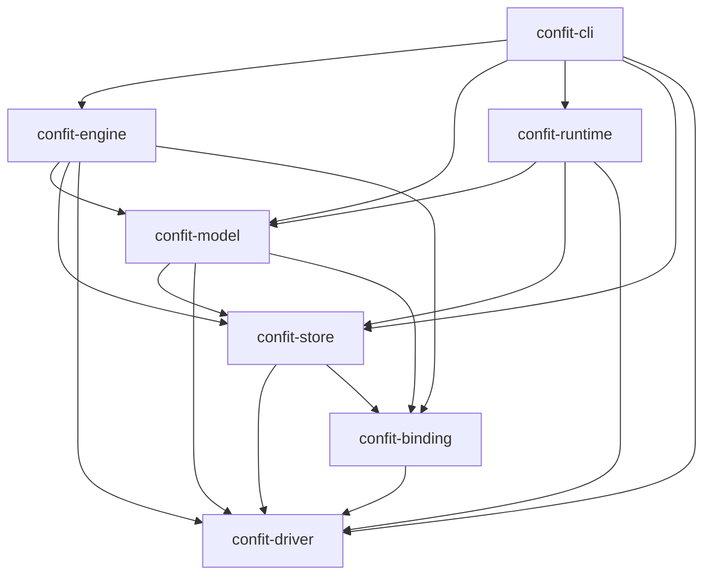

# ConfIt architecture

## Dependencies

These edges are the whole graph. Binding macros feed the
derive layer at build time.

## confit-model

Model owns the shared entities for the whole
program life cycle. It contains the definitions
with annotations to generate the Lua api and
to make them serializable and deserializable.

## confit-driver

Side effects with third-party libs cut to the used surface.

## confit-store

Domain file access for slots, blobs, fetched and project
resources.

## confit-runtime

Destination writes alone.

## confit-engine

Lua profiles evaluate into documents and blob refs over
handles.

## confit-cli

Terminal surface over evaluation and plans.

## confit-binding

Domain-agnostic face toolkit for Lua bindings.

## Data flow

The profile evaluates to documents with blob refs. The
build fills hashes and diffs desired documents against the
previous manifest. Caches hold across runs: fetch skips
downloads, extracts skip unpacks through recorded hashes,
puts skip present blobs through the content index. Text
and structured payloads stay inline in the manifest.
Apply writes documents per kind, removes state-recorded
paths absent from desired documents, records the applied
slot, rotates history and persists blobs into the pool.
