# CLI

Confit accepts one command. Top level flags come before the
command name. Short flags follow the subcommand name. A top
level flag after the subcommand ends with exit 2.

| Command | Purpose |
| --- | --- |
| `bundle` | evaluate a profile into a bundle or named state |
| `check` | preview the profile against stored state |
| `apply` | write the project onto the machine |
| `restore` | write one bundle or stored state |
| `export` | pack one state or print its manifest |
| `delete` | delete one named state and prune blobs |
| `init` | scaffold a project or refresh a target |

`PROJECT` is a folder. The default profile is `main.lua`
inside that folder. An absent folder fails as a missing
project. An explicit profile that is absent fails as an
unreadable profile. A relative `--profile` path resolves
against the project folder. An absolute path stays as is.
A state picker stays literal. `@name` and `%N` keep picker
meaning. The command creates the logs folder and opens
`confit.log` before dispatch. A folder or file failure ends
with exit 1.

`--json` writes the result object on stdout. Full shapes live
in [Schemas](schemas.md). Each command names its shape below.
Only `--json` and `export -m` write stdout. All other output
uses stderr. [Output](output.md) states previews, prompts,
tables, and log lines in full.

`--ui` accepts `auto`, `plain`, `inline`, and `none`. The
default is `auto`. `auto` picks `inline` on a terminal and
`plain` on a pipe. All interactivity uses stderr. With `none`
the command prints only the `Log:` line on stderr and asks
approval only with `-f`. [Output](output.md) states backend
choice in full.

`--view` selects the preview view. [Views](#views) lists
accepted values and defaults per command.

The complete synopsis:

```sh
confit bundle PROJECT [--profile FILE] -o PATH|@name [--view VIEW] [--force]
confit check PROJECT [--profile FILE] [--view VIEW]
confit apply PROJECT [--profile FILE] [--view VIEW] [--force]
confit restore SOURCE [--view VIEW] [--force]
confit export [PICKER] [-o PATH] [-m|--manifest]
confit delete @name
confit init [DIR] [--stubs] [--plugins] [--lsp]
```

## bundle

```sh
confit bundle PROJECT [--profile FILE] -o PATH|@name [--view VIEW] [--force]
```

| Flag | Value | Default | Behavior |
| --- | --- | --- | --- |
| `-p`, `--profile` | file | `main.lua` | profile file to evaluate |
| `-o`, `--output` | path or `@name` | required | a path writes a bundle file and gains a `.cb` extension when absent, an existing `.cb` or `.CB` extension is kept; `@name` stores a named state and persists referenced content in the pool; an empty name, `/`, `\`, NUL byte, `.`, or `..` fails |
| `--view` | view name | `desired` | see [Views](#views) |
| `-f`, `--force` | none | off | skips the prompt; a decline ends with `Cancelled.` and exit 0 |

`bundle` evaluates the profile and builds the manifest. The
manifest records hooks for later commands.

`--json` prints [Bundle result](schemas.md#bundle-result).



## check

```sh
confit check PROJECT [--profile FILE] [--view VIEW]
```

| Flag | Value | Default | Behavior |
| --- | --- | --- | --- |
| `-p`, `--profile` | file | `main.lua` | profile file to evaluate |
| `--view` | view name | `desired` | see [Views](#views) |

`check` evaluates the profile and builds the manifest. It
compares the manifest with the applied state and with disk,
shows the preview, and ends after the preview. Disk writes
stay limited to the log file.

`--json` prints [Check result](schemas.md#check-result).



## apply

```sh
confit apply PROJECT [--profile FILE] [--view VIEW] [--force]
```

| Flag | Value | Default | Behavior |
| --- | --- | --- | --- |
| `-p`, `--profile` | file | `main.lua` | profile file to evaluate |
| `--view` | view name | `effective` | see [Views](#views) |
| `-f`, `--force` | none | off | skips the prompt; a decline ends with `Cancelled.` and exit 0 |

`apply` evaluates the profile and persists content in the
pool. After approval the command writes documents, removes
dropped paths, stores the applied state, rotates history,
drops orphan blobs, and starts hooks in profile order.

`--json` prints [Apply result](schemas.md#apply-result).



## restore

```sh
confit restore SOURCE [--view VIEW] [--force]
```

| Flag | Value | Default | Behavior |
| --- | --- | --- | --- |
| `--view` | view name | `effective` | see [Views](#views) |
| `-f`, `--force` | none | off | skips the prompt; a decline ends with `Cancelled.` and exit 0 |

`SOURCE` takes one of these forms:

| Source | Resolution |
| --- | --- |
| path ending in `.cb` | bundle file, case-insensitive extension |
| `@name` | named state |
| `@!` | rescue capture, the pre-command capture |
| `%N` | history entry, newest first from 1 |

`restore` restores a stored state from `SOURCE`. The manifest is already
built. The artifacts come from the pool or the bundle. The command follows
the apply sequence. A source with a form outside the table fails as an
invalid restore source. After approval the restored manifest becomes the
applied state.

> [!NOTE]
> Unlike `apply`, the command doesn't receive `PROJECT`.

`--json` prints [Restore result](schemas.md#restore-result).



## export

```sh
confit export [PICKER] [-o PATH] [-m|--manifest]
```

| Flag | Value | Default | Behavior |
| --- | --- | --- | --- |
| `-o`, `--output` | bundle path | auto name from the picker table | writes a bundle file and gains a `.cb` extension when absent; conflicts with `-m`, exit 2 |
| `-m`, `--manifest` | none | off | prints the manifest; conflicts with `-o`, exit 2 |

The picker takes one of these forms:

| Picker | File |
| --- | --- |
| absent | `applied.cb` |
| `@name` | `{name}.cb` |
| `%N` | `prev-{N}.cb` |

`export` packs one stored state into a bundle file in the
current folder. Content comes from the pool or the cache. An
absent entry or picker fails.

`-m` prints [Manifest](schemas.md#manifest).



## delete

```sh
confit delete @name
```

`delete` accepts only an `@name` picker. A bare name and `%N`
fail. The command removes `states/{name}.json` and drops pool
entries referenced only by the deleted state. Entries of the
applied state, history entries, and other named states stay. A
name with an absent state fails.

`--json` prints [Delete result](schemas.md#delete-result).



## init

```sh
confit init [DIR] [--stubs] [--plugins] [--lsp]
```

| Flag | Value | Default | Behavior |
| --- | --- | --- | --- |
| `--stubs` | none | off | overwrites the stubs folder |
| `--plugins` | none | off | overwrites the core plugins folder |
| `--lsp` | none | off | overwrites the editor config |

A refresh flag limits the command to flagged targets. Flags combine and the
tree shows every flagged target.

`init` scaffolds a project in `DIR` with a profile, a project
file, stubs, core plugins, and editor config. `DIR` defaults
to the current folder. The command refuses a present
destination.

`--json` prints [Init result](schemas.md#init-result).



## Views

`--view` accepts `desired` and `effective`. `desired` shows
wanted changes against recorded changes. `effective` shows
wanted changes against disk changes. Defaults per command:

| Command | Default |
| --- | --- |
| `bundle` | `desired` |
| `check` | `desired` |
| `apply` | `effective` |
| `restore` | `effective` |

## Global flags

`--logs-dir DIR` sets the folder for `confit.log` and the
`hooks` subfolder. The flag wins over `CONFIT_LOG_DIR`. The
fallback is the OS temp folder and `confit-{pid}`.

`--log-level LEVEL` accepts `off`, `error`, `warn`, `info`,
`debug`, and `trace`. The default is `warn`. The level filters
messages in `confit.log`. Terminal output keeps the same form
across levels.

## Exits

Exit 0 marks success. A declined prompt ends with
`Cancelled.` and exit 0. Exit 1 marks a failed command. Exit 2
marks a usage error. A failure prints a summary line and a
closing line. A usage error prints the parser message and usage. `--help` and
`--version` end with exit 0. [Output](output.md) states
streams, previews, prompts, and log lines in full.

> [!NOTE]
> A pool drop failure prints only its summary line.
