# Difference

The command compares manifests three ways. Each way is one JSON view with
`changes` and `kind`. The JSON document holds `recorded` and `wanted` beside
the views. Every change carries a `drifted` boolean. The drift view holds
recorded against disk, and its own entries carry `drifted` as false. The
effective view holds wanted against disk. An effective entry marks `drifted`
as true when disk drift caused it. The desired view holds wanted against
recorded. The `--view` flag selects `desired` or `effective` for the preview.
Full shapes live in [Schemas](schemas.md).

## Views

| View | Compares |
| --- | --- |
| `desired` | wanted against recorded |
| `drift` | recorded against disk |
| `effective` | wanted against disk |

A change kind is `addition`, `change`, or `removal`. A recorded manifest
without documents leaves drift empty. The command shows additions in desired
and effective on first use. Desired and effective diverge on drifted disk and
match when disk matches recorded.

## Tiers

Equal hashes mean unchanged, and no comparison runs. Differing hashes compare
once with the coarser method:

- Structured against text, rc, and link target text compares as rendered
  content.
- Anything against opaque compares as hashes. Those hashes already differ, so
  the document updates with no further content.
- Equal content on disk means unchanged, even across kinds.
- A mode mismatch forces an update.
- A recorded document absent from the desired manifest is a delete.
- A kind change at one path reads as one update. The kind selects the
  comparison method.

## Per kind

| Kind | Compares |
| --- | --- |
| Structured | the recorded data against the disk parsed in the same format |
| Text | the rendered content against the disk content |
| Rc | the rendered rc text against the disk content |
| Link | the recorded target text against the disk link target |
| Opaque | the recorded content hash against the disk hash |
| Tree | each declared member by hash, then by mode |

- Structured parses the disk in the same format and compares leaf by leaf. An
  unparsable disk falls back to byte comparison. Formatting-only differences
  are equal.
- Text compares the rendered content against the disk content.
- Rc renders the guard and every entry first, then compares content.
- Link compares the recorded target text against the disk link target.
- Opaque compares the recorded content hash against the disk hash. The value
  shows `sha256:{hex} ({n} bytes)`.
- Tree compares each declared member by hash, then by mode. An extra file
  under the tree folder doesn't count.
- A text document marked `unmanaged` skips content comparison. An unmanaged
  opaque document still compares its content hash. A missing destination still
  reports.

## Modes

A text document and an opaque document carry a mode, and a tree member carries
a mode. Structured, link, and rc documents don't carry a mode. A mode mismatch
forces an update.
