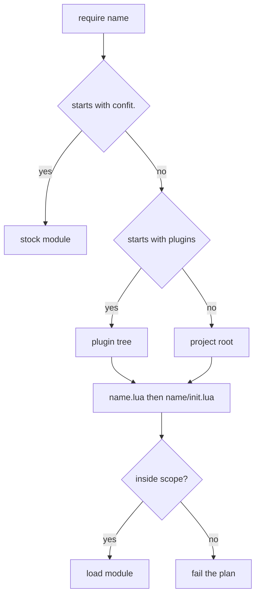

# ConfIt v0.9 design notes

Notes behind v0.9.

Status: In progress

## Why I stopped 0.8.1

The tool used around 300 MB for a normal cli job. For a tool that reads some
files and writes them, that is too much. I analyzed it with mete and other
tools, and the problem was the architecture itself.

I said effects happen in cli alone. The old filesystem abstraction spread them
through every module and left ownership unclear. Surface code that should only
translate Lua into Rust had a 500 line file uncompressing data.

Core did everything. Cli called core for everything. Core had the effects, the
transforms, the logic and the shared types. Lua evaluation and parts of
compression lived there too.

v0.8 lowered the memory, but the base stayed the same. I removed whole-bundle
materialization, and the code still materialized everything. Lua held data in
gc, Rust copied it for comparisons and kept it for the whole run, downloads,
archives and their contents, whole trees. The abstraction returned whole files,
so every path that should stream was closed.

The domain stayed unclear. The resource idea stayed in my head, and telling a
resource (profile input) apart from a route (profile output) was hard at every
step. The abstraction tested well and reused badly. I passed it through every
layer, and a small change meant rewriting a large part of the code. I stopped
0.8.1 for 0.9. Making it lazy meant rewriting almost 80% of the code, and the
integration tests broke in the same move because they depended on everything.

## What I want from 0.9

I want the domain clear. Plan-time resources are the profile input. Apply-time
documents are the profile output. I put the effects in driver, the caches and
the pool in the store, and the destinations in runtime. The upper layers ask for
what they need, and the lower layers do the file work.

I want the machine to stop carrying whole files. Big bytes should move from
source to destination while memory stays flat. Small values can stay in memory
because rendering them is cheap.

I want one job per crate. Each piece of work happens once. A layer trusts the
type it gets, and the check runs once at the edge. A type has a valid state, so
a bad value fails with a good message.

I want preview to show the diff and leave the disk as found.

## The API got smaller

The old API had a constructor for every shape, and each shape needed its own
handle. Profiles were static, and every small behavior change meant a wrapper.
The mise plugin exists because I needed to extend what the core did.

What makes it smaller is that everything is data now. With plain tables the
constructors went away, except `Id`, `Route`, `ResourceHandle` and
`ArchiveHandle`. Those four stayed userdata because they have private confit
state. `Id` and `Route` have the Lua declaration stack, so a mistyped
destination or a repeated name can point at the line that wrote it.
`ResourceHandle` and `ArchiveHandle` have a verified source and its hash.
Plugins took the fancy parts. A smaller API is more flexible, and the cost is
verbosity. Plugins hide the verbosity. Lua now does the work of several old
helpers, or a plain value represents it better.

Flexibility brought mistakes. An old constructor checked its arguments at
creation and failed at the line that built the value. A plain table can have a
bad shape. I added `confit.validate` so plugins can check their inputs again.
It takes a document, config, patch, hook, condition, entry or route, and
returns the value, or nil and a reason. A plugin can validate its input at the
top of a function, fail fast, and stop bad data before the rest. I dropped the
cycle and array helpers because validate and plain tables cover those cases.

The simpler shapes are also faster in memory and, for a reason I am still
working out, faster at runtime. Reading once and keeping data in memory should
be faster because it cut the disk reads. My theory is that moving every byte
into Lua and back cost more than the reads we saved, and the gc had more work. I
have a theory, but I want to claim only what I saw.

I used uncompressing to show the change. The old API took an archive path and a
callback, and the callback returned a document for each member. The new API
gives you an archive handle. You list the members and write a normal Lua loop:

```lua
local tree = { path = dest, members = {} }
local archive = assert(handle:archive())

for _, name in ipairs(assert(archive:members())) do
  if name:match("%.ttf$") then
    tree.members[name:match("[^/]+$")] = assert(archive:member(name))
  end
end
```

That is plain Lua. The profile is Lua, and it can filter, rename or skip
members on its own.

Tree was a function with an archive and a picker callback. It returned a list of
members with a relative path, a mode and a source path. Now tree is a document
body. It has a `path` and a `members` map, and each member is a handle or
`{ handle, mode }`. The map stores flat relative paths. The diff is a direct
comparison over the map.

## Inputs are handles

Inputs crossed as strings. The old resources namespace read whole files into Lua
strings, and the text fetch downloaded the whole body before making the string.
A missing file threw, and a fetch had its own function per view. The string or
cache path had no handle and no project-file hash, so the consumer had no
identity to trust.

`confit.open` and `confit.fetch` fixed that. `open` takes a project path.
`fetch` takes a url and an optional `sha256` pin. Both return one
`ResourceHandle`, and the handle has the verified source and its hash. The
profile can read text, load a table, or open an archive when needed. Opaque
documents pass the handle through, so the bytes stay in Rust.

```lua
local handle = assert(open("resources/starship.toml"))
local text = assert(handle:text())
local data = assert(handle:load())
```

An absent read is nil and a reason, so a profile can branch on it. A failed
fetch is like a missing file.

`load` parses JSON, TOML, YAML and INI. An archive handle has its members in
sorted order and can open one member.

```lua
local archive = assert(handle:archive())
local paths = assert(archive:members())
local member = assert(archive:member("mise/bin/mise"))
```

Project files are hashed once, when the handle is created. `text` and `load`
read when needed.

A route is composed of a base and a relative path. The host folder resolves
when apply writes, so a bundle travels across machines and users.

`id` and `route` are the two global constructors. The rest loads through
`require`. `route` replaced the old path helpers. `id` is new, because configs
and hooks need an identity with the declaration site.

`confit.fact` exists for the same reason routes do, in the other direction.
Routes let a bundle travel across devices. Facts say which device the bundle
needs. A bundle only works where `os` and `arch` match. The `version` fact
protects plugins, because a plugin moves independently from the core binary and
the version tells it when the API changed, so the plugin can refuse fast.

```lua
local fact = require("confit.fact")
local version = fact("version")
```

`confit.template` exists because templating is super important in this kind of
app. I wanted it in the simplest way. I even thought about making it global, but
only identity belongs there. So template is a module.

```lua
local render = require("confit.template")
local text = assert(render("theme = {{ theme }}", { theme = "catppuccin" }))
```

A profile has `configs` and `documents`. Both are lists. A document has its own
`path`.

```lua
return {
  configs = { bat, shell },
  documents = {
    { path = route("home", ".bashrc"), profile = {}, config = {}, final = {} },
    { path = route("config", "bat/config"), text = "--theme=\"Catppuccin Mocha\"\n" },
  },
}
```

A config was a handle mutated through methods. It is a plain table now. It has a
required `name` and optional `documents`, `patches`, `hooks` and `requirements`.
Profiles build it with literals, pass it to helpers, filter it with
conditionals, and return it. A sugar plugin can offer the add helper, so authors
keep method syntax and the core has no construction code.

```lua
local bat = {
  name = id("bat"),
  documents = {
    { path = route("config", "bat/config"), text = "--theme=\"Catppuccin Mocha\"\n" },
  },
  patches = {},
  hooks = {},
  requirements = {},
}
```

Documents lived in maps keyed by path. Config and profile document collections
are lists now, and the path is inside the document. Declaration order is intact,
and two configs can declare documents without sharing a key space.

The document body is one flat table. The body keys tell the kind. Each body has
its own keys, so editors can list the fields of every kind without narrowing the
table.

```lua
{ path = dest, text = "..." }
{ path = dest, format = "toml", data = { tools = {} } }
{ path = dest, target = other }
{ path = dest, handle = handle, mode = "755" }
{ path = dest, members = { ["font.ttf"] = handle } }
{ path = dest, profile = {}, config = {}, final = {} }
```

Opaque bodies have a `handle`. A tree body has a `members` map. Each key is a
relative path, and each value is a handle or `{ handle, mode }`. The map stores
flat relative paths. A nested folder is just a path with a slash in it.

Rc entries and conditions came from constructor calls. They are tagged tables
now.

```lua
{ env = { name = "EDITOR", value = "nvim" } }
{ alias = { name = "ll", expansion = "ls -l" } }
{ eval = { argv = { "mise", "activate", "bash" } } }

{ in_path = { name = "mise" } }
{ changed = { route = route("config", "mise/config.toml") } }
{ all = {
    { in_path = { name = "mise" } },
    { changed = { route = route("config", "mise/config.toml") } },
  } }
```

A condition can guard an rc entry with `when`.

## Hooks and patches

Hooks were merged, and one gate answered two questions. A hook with nothing
under it changed reported it could not run. The report mixed inability with no
need.

Hooks are plain tables now. `argv` is non-empty, and each argument is a string
or a route. `path` is optional. `id` is required, and repeated ids fail before
any patch runs. `requires`, `when` and `check` are optional conditions. `check`
is singular. A `checks` field is rejected. `timeout` takes duration text, and
the default is 600 seconds.

```lua
{
  id = id("plugin:_/mise:install"),
  argv = { "mise", "install" },
  path = { route("home", ".local/bin") },
  requires = { in_path = { name = "mise" } },
  when = { changed = { route = route("config", "mise/config.toml") } },
  timeout = "10m",
}
```

Hooks stay as declared. A closed `requires` stops the apply. A closed `when` or
a passing `check` is logged and skipped. Hooks run after the documents, the
state and the history are written.

The old patch API was close to this one. A patch was userdata, and that made it
inflexible. With tables I can add and remove fields, read everything as a field,
and map records to tables. The new patch is a plain table. It has a `target` or
a `filter`, an `apply` callback, and an optional `priority`.

```lua
{
  target = route("config", "mise/config.toml"),
  format = "toml",
  apply = function(document)
    document.data.tools.bat = "0.24.0"
  end,
}
```

```lua
{
  filter = function(route)
    return route:base() == "home" and route:relative():match("^%.%a+rc$") ~= nil
  end,
  apply = function(document)
    table.insert(document.config, { alias = { name = "ll", expansion = "ls -l" } })
  end,
}
```

The selector is new. One patch covers several documents, because rc is just
another document now. Adding something to different shells needs several
documents patched at once. Hook patches are new too. Hooks no longer merge
automatically, so a hook condition is patched by hook id.

The patch kind is inferred. A string `target` is a hook patch. A `format` field
is a structured patch. Anything else is an rc patch. There is no `kind` field
and no `match` field. The `apply` callback receives one live document table. A
patch has one destination form: a `target` or a `filter`. `priority` is one of
`minor`, `low`, `normal`, `high`, `major`, and the default is `normal`. Patches
run in destination order, and the earlier write wins.

## Shells are documents

`{{shell}}` treated the shell as a value. The profile had a list of shells, and
the engine built hidden rc documents. Patching a missing document created it, so
a typo slipped through as a new file.

So the shell is a document. Each shell is an rc document. The profile lists
every rc document.

```lua
return {
  documents = {
    { path = route("home", ".bashrc"), profile = {}, config = {}, final = {} },
    { path = route("home", ".zshrc"), profile = {}, config = {}, final = {} },
  },
}
```

Filter patches replaced templating. One patch runs across all rc documents, and
the callback receives the route so it knows which shell it patches.

```lua
{
  filter = function(route)
    return route:base() == "home" and route:relative():match("^%.%a+rc$") ~= nil
  end,
  apply = function(document)
    local shell = document.path:relative():match("^%.(%a+)rc$")
    table.insert(document.profile, {
      eval = { argv = { "mise", "activate", shell } },
    })
  end,
}
```

Mise has one filter patch over all rc documents, so all shell logic is in the
patch. A target points at an existing document. A mistyped target fails the
plan.

## Require and project shape

A plugin file looked like a require module but needed a `.d.lua` pair to tell
the language server it lived in the global.

Profiles use plain `require` with dot-separated paths. Resolution tries
`name.lua`, then `name/init.lua`. A path starting with `plugins` resolves under
the configured plugin tree. Any other path resolves under the project root. A
plugin declares `---@module` in one file, and that file has the code and the
types.

```lua
local sugar = require("plugins._.sugar")
local bat = require("tools.bat")
```

A plugin caller stays inside the plugin tree. Project code can require any
contained file. Backslashes, drive prefixes and absolute paths fail as module
paths. Escaping symlinks fail the containment check.



There were too many flags. `project.toml` makes the shape unique per project,
and the same overrides generate the luals json. The file has the scaffold
version, the plugin folder and its outside flag, and the stubs folder. The run
and shape flags live in the config.

`--re-fetch` is gone. The cache lives in the OS session and clears after a
restart, a corrupt download never gets stored, and a path argument covers the
rest. The url is the hash anyway.

```toml
version = "0.9.0"

[plugins]
folder = "plugins"
allow_external_folders = false

[stubs]
folder = "stubs"
```

Unknown fields are rejected. `init` writes `main.lua`, `project.toml`, the stubs
and the core plugins. It refuses existing destinations. `--stubs`, `--plugins`
and `--lsp` overwrite their targets. The default profile is `main.lua`.

## Errors and output

The whole project used one generic error with a free text message and a raw
input/output failure. It had no structure, no context from where the failure was
born, and no single source of truth for the terminal.

The error work has four parts. Terminal unification, so the terminal has one
shape. Layered errors, so a failure can bubble up and gain context from birth to
completion. Context in the log. And homogeneous errors, so every layer has the
same language. One error shape has the operation, the cause and the context.
The operation is what was being done, the cause is the domain failure, and the
context is the typed location and diagnostic data.

A terminal failure prints `error:` with the summary and a closing line.

```text
error: Cannot load '~/.config/confit/state.json' manifest, invalid version: 8
For more information please see the log
```

A failed run exits 1. A clap usage error exits 2. A declined apply exits 0.

The log is JSON. It has `error`, `reason` (the serialized context), and an
optional `trace`. Suggestions are Damerau-Levenshtein within distance 3, capped
at 5. They are written to the log. They are not printed on stderr. Declaration
traces are written to the log too. Only Lua failures print a trace on stderr.
Evaluate errors ignore the trace, the sources and the suggestions on stderr.

Diff warnings are non-blocking. Before an error, the log path is written by
apply. Plan has the diff alone.
